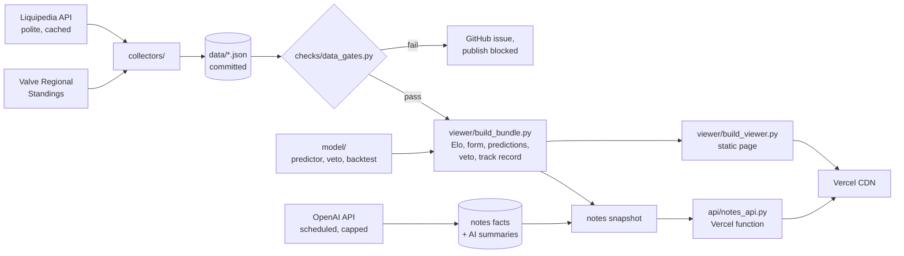

# Face-Off

**Calibrated win probabilities, map-veto simulation and evidence-backed match context for professional Counter-Strike 2.**

**Live site:** [cs2faceoffanalytics.vercel.app](https://cs2faceoffanalytics.vercel.app/) · rebuilt automatically from fresh data several times a day

[](https://github.com/AverageNftEnjoyer/Face-Off/actions/workflows/daily-refresh.yml)
[](https://github.com/AverageNftEnjoyer/Face-Off/actions/workflows/live-refresh.yml)


Face-Off predicts every tracked S- and A-tier CS2 series. Each prediction comes with an
honest uncertainty band, the simulated map veto, the factors behind the number, and a
fact sheet of the context a human analyst would check before the match. Every number on
the site is a pure function of committed data, recomputed at build time, and every
prediction is computed strictly from information available before the match.

> Fan analytics, not betting advice. Not affiliated with Valve, HLTV, Liquipedia or any team.

---

## Contents

- [What you get](#what-you-get)
- [How good is it?](#how-good-is-it)
- [How it works](#how-it-works)
- [Design principles](#design-principles)
- [Repository tour](#repository-tour)
- [Run it locally](#run-it-locally)
- [Automation](#automation)
- [The notes engine and its tool interface](#the-notes-engine-and-its-tool-interface)
- [Quality and testing](#quality-and-testing)
- [Contributing](#contributing)
- [Data sources](#data-sources)
- [Engineering highlights](#engineering-highlights)

---

## What you get

| Feature | What it shows |
|---|---|
| **Match predictions** | Win probability for BO1, BO3 and BO5 with a 90% confidence band, scoreline odds, and a reliability label ("clear read" through "close or uncertain"). |
| **Veto simulation** | The full probability distribution over legal map vetoes, the most likely veto, and per-map win chances. |
| **What moves the number** | Each factor's contribution in percentage points: team strength, last 30 days, last 5 series, head-to-head, roster. |
| **Notes tab** | "Why the model picks X" in plain English, plus a fact sheet for both teams (last match, rest days, schedule load, streak, last 10 results, the current five and their days together, player form) and the head-to-head record. |
| **Matchup tools** | Any two tracked teams, today or inside a specific tournament, with the same depth as a scheduled match. |
| **Tournaments** | Schedules, results, group tables, brackets, standings, and the model's pre-match call on every match. |
| **Team pages** | Elo history, map pool, roster, results (including lower-tier events), and team facts. |
| **Track record** | Every pre-match call graded after the fact, a calibration chart, and an Elo-only baseline for comparison, with in-sample calls excluded. |

---

## How good is it?

The numbers below are measured on the **739 series played after the weights were last fitted**
(Oct 2025 – Oct 2026), each predicted only from data available before it was played
(`evaluation/walkforward.py`):

| Model | Accuracy | Brier score | Log loss |
|---|---|---|---|
| Face-Off engine (shipped) | 63.9% | 0.218 | 0.625 |
| Elo only (baseline) | 64.1% | 0.217 | 0.624 |

The engine is **as accurate as a strong Elo baseline and well calibrated**: when it says 70%,
teams win about 70% of the time, and each calibration bucket passes its pre-registered test.
It does not yet *beat* Elo on held-out data. The site says so on its Stats page, and the
walk-forward report records which acceptance tests pass (calibration) and which do not
(beating the baseline).

That is deliberate policy. A factor ships with predictive weight only if it shows signal on
held-out data. For example, roster tenure was built, tested, failed, and now appears only as
display context.

---

## How it works



1. **Collect.** `collectors/` fetches tournament pages from Liquipedia's MediaWiki API, with a 2.5 s gap between requests, on-disk caching and retries. Valve's regional standings and lineups come from Valve's public repository. Everything lands in `data/` as JSON, with `data/matches.json` as the single source of results.
2. **Gate.** `checks/data_gates.py` checks every rebuild before it can be published: schema, duplicates, counts, team names, Elo bounds, and agreement with an independent second results source. A failing gate blocks the publish and opens a GitHub issue with the report.
3. **Model.** `model/backtest.py` replays history day by day into a point-in-time Elo and feature timeline. `model/predictor.py` blends the factors into a log-odds estimate with an uncertainty band, and `model/veto.py` computes the exact probability distribution over map vetoes.
4. **Bundle.** `viewer/build_bundle.py` computes everything the site shows into one versioned bundle, `viewer/data-bundle.json`, whose schema is documented in `docs/bundle-schema.md`. The same inputs always produce byte-identical output.
5. **Render.** `viewer/build_viewer.py` turns the bundle into a single static page served by Vercel. There is no database and no per-request work, except the notes endpoint below.
6. **Notes on demand.** The Notes tab asks `api/notes_api.py`, a serverless function, for a matchup's fact sheet. The function runs the same engine as the command line, and responses are cached at the CDN, keyed to the data snapshot.

The full module map, data-file ownership and change log are in **[ARCHITECTURE.md](ARCHITECTURE.md)**.

---

## Design principles

- **Point-in-time, provably.** A series played on day D sees only outcomes dated before D. `evaluation/leakage_check.py` proves it on every feature in three ways:
  - it scrambles every outcome dated D or later and checks no feature changes
  - it truncates the history and checks the same
  - it runs a deliberately leaky "canary" builder that the check must catch
- **Honest uncertainty.** Every prediction carries a 90% band. Wide bands are expected and correct; being wrong with false confidence is treated as the failure mode.
- **Strength counted once.** Elo is the only factor that says who is better. Form, head-to-head and maps are measured relative to what the rating already implies, so the same evidence is never counted twice.
- **Context is not signal.** The notes and fact sheet are display only. Nothing in them feeds the predictor, and every surface says so.
- **Deterministic and reproducible.** Same inputs, same bytes. Generated timestamps are pinned for reproducible builds.
- **Standard library only.** No pip installs anywhere, which keeps CI and Vercel builds fast and nothing ever breaks on a dependency update.

---

## Repository tour

| Folder | Role |
|---|---|
| [`model/`](model/) | The prediction engine (`predictor.py`), veto engine (`veto.py`), point-in-time history (`backtest.py`), lineup and tenure features, and the notes engine (`notes.py`). |
| [`evaluation/`](evaluation/) | Walk-forward evaluation, weight fitting, leakage proofs, and the notes rule evaluation. |
| [`collectors/`](collectors/) | Liquipedia and Valve fetchers and parsers, plus the web-fact fetcher and AI summarizer for notes. |
| [`pipeline/`](pipeline/) | Scheduled refresh jobs, the lower-tier backfill, and roster review and promotion. |
| [`checks/`](checks/) | Data-quality gates, the cross-source check, and freshness validation. |
| [`viewer/`](viewer/) | The bundle and page builders and the page template. |
| [`api/`](api/) | Vercel serverless function: the on-demand notes endpoint. |
| [`tests/`](tests/) | `unittest` suite, one `test_<area>.py` per area. |
| [`data/`](data/) | Committed data only, never code. Sources and terms are in [`data/SOURCES.md`](data/SOURCES.md). |
| [`docs/`](docs/) | Bundle schema, notes contracts, and the LLM tool manifest. |

Folders are grouped by role. They are not Python packages: every script starts with a two-line
`paths` bootstrap that puts all code folders on `sys.path`, so modules import each other by
flat name and every script runs directly from the repository root.

---

## Run it locally

Requires Python 3.12+. Nothing to install.

```sh
git clone https://github.com/AverageNftEnjoyer/Face-Off.git
cd Face-Off

python -m unittest discover -s tests                  # full test suite (~1.5 min)
python viewer/build_bundle.py viewer/data-bundle.json # compute the bundle (~1.5 min)
python viewer/build_viewer.py out/index.html          # render the site; open out/index.html
```

Useful entry points:

```sh
python model/predictor.py --test                      # the engine's built-in example
python model/notes.py --a Aurora --b NiP --date latest  # matchup notes + fact sheet as JSON
python api/notes_api.py --serve                       # the notes endpoint on localhost:8787
python evaluation/leakage_check.py                    # point-in-time proof (all tests)
python evaluation/walkforward.py                      # walk-forward evaluation
python pipeline/daily_refresh.py --live               # refresh running events (network)
```

To see the Notes tab working on a local build, start the endpoint and open
`out/index.html?notesapi=http://127.0.0.1:8787/api/notes_api`.

---

## Automation

| Workflow | When | What it does |
|---|---|---|
| `daily-refresh.yml` | Every 6 h, plus nightly | Refresh from Liquipedia → data gates → bundle → tests → page build → commit and push → roster-review issue → freshness checks |
| `live-refresh.yml` | Every 15 min while an event runs | Refresh running events only → gates → push |
| `validate.yml` | Every 30 min | Compares Liquipedia, the repository and the deployed site; restarts the live refresh if the site is behind |
| `notes-facts.yml` | Daily | Player-form and roster facts via OpenAI web search, then AI "why" summaries for scheduled matches. Each has a hard monthly budget. |

Every push to `main` triggers a Vercel rebuild. Failures are loud: a red gate or a failed
fetch opens a GitHub issue rather than silently publishing stale or wrong data.

---

## The notes engine and its tool interface

The notes engine (`model/notes.py`) turns dated data into deterministic, evidence-carrying
context. It has two parts:

- **Rules:** short rest, heavy schedule, weeks without an official match, roster tenure, new players, win/loss streaks, revenge matches, hot or cold players, stand-ins and labelled rumours.
- **Fact sheet:** the plain numbers behind those rules, always filled whether or not a rule fired.

The same functions serve three consumers:

- **the site**, through `api/notes_api.py`, cached per data snapshot
- **humans**, through the command line, `python model/notes.py`
- **LLM agents**, through a versioned tool manifest, [`docs/notes-tool-manifest.json`](docs/notes-tool-manifest.json), that a model with no other knowledge of the codebase can call correctly

The "why the model picks X" summary is written by an AI from the model's own numbers, for
scheduled matches only. A **grounding check** rejects any summary that contains a number
not present in its input, so the text can rephrase but not invent. Other matchups get a
rule-based summary from the same numbers.

Contracts (fact schema, note schema, HTTP API, asof semantics):
[`docs/notes-contracts.md`](docs/notes-contracts.md).

---

## Quality and testing

- **385 `unittest` tests** covering:
  - the engine, veto, backtest and walk-forward
  - data gates and cross-source checks
  - the notes engine, endpoint, fetcher and summarizer
  - the page's bundle contract, and the architecture document itself
- **Leakage proofs**: scramble, truncate and canary tests for every feature, including the notes.
- **Architecture as a test.** `tests/test_architecture.py` fails if a code file is missing from the module map in `ARCHITECTURE.md`, or if code appears outside the code folders.
- **Drift checks.** The page refuses a bundle whose schema version it does not understand, and the build fails if the template references a bundle field that does not exist.
- **Spend controls.** Every LLM call is capped per run and per month, the API key is redacted from all committed output, and the site itself holds no key.

---

## Contributing

Contributions are welcome. Before opening a pull request:

1. Read **[ARCHITECTURE.md](ARCHITECTURE.md)**: the module map, data flow and change log.
2. Follow the house rules:
   - **Standard library only**: Vercel and CI install nothing.
   - **Code goes only in the code folders** (`paths.CODE_DIRS`), and `data/` holds data only.
   - **Module names are unique across folders**: they share one import namespace.
   - **New scripts and tests start with the two-line `paths` bootstrap.**
   - **Data paths come from `paths.DATA` / `paths.RAW`**, never relative to a module's own file.
3. Keep `ARCHITECTURE.md` current in the same change:
   - the module-map row for any added, moved or renamed file
   - a dated change-log line for anything that touches structure, data flow or visible behaviour
4. A new predictive factor must earn its weight on held-out data (`evaluation/walkforward.py`) and pass the leakage check. Otherwise it ships as display context or not at all.
5. Run the checks:

   ```sh
   python -m unittest discover -s tests
   python viewer/build_bundle.py viewer/data-bundle.json && python viewer/build_viewer.py out/index.html
   ```

Roster changes are reviewed by hand. The scraper proposes a candidate file, and
`python pipeline/promote_rosters.py --yes` promotes it after review.

---

## Data sources

- **[Liquipedia](https://liquipedia.net/counterstrike/)**: tournaments, results, rosters and stand-ins. Fetched through the MediaWiki API with rate limiting and caching, per Liquipedia's API terms; text content is CC BY-SA 3.0, with attribution.
- **[Valve Regional Standings](https://github.com/ValveSoftware/counter-strike_regional_standings)**: rankings, per-match lineups, and a second results source for cross-checking.
- **OpenAI API**: player-form and roster facts (via web search, each with its source link), and the plain-English summaries. Scheduled jobs only, under hard monthly budgets.

Details, terms and politeness rules: [`data/SOURCES.md`](data/SOURCES.md).

---

## Engineering highlights

- **A production data pipeline on free infrastructure**:
  - scheduled ingestion, quality gates and self-healing refreshes
  - a static CDN site plus one serverless function
  - no database and no paid servers
- **Statistical honesty built in**:
  - walk-forward evaluation with pre-registered acceptance tests
  - calibration checks and an always-visible baseline
  - leakage proofs that include deliberately leaky canaries to show the checks work
- **Deterministic, reproducible builds.** Byte-identical output for identical inputs, and the bundle has a versioned, documented schema.
- **LLMs used safely**:
  - AI writes prose only from the engine's numbers, with a grounding check
  - the facts it gathers are schema-validated and must cite a source
  - budgets are hard-capped and the key is redacted from all output
  - a versioned tool manifest lets agents use the engine as a tool
- **Zero dependencies.** Everything, from the HTTP client to the PNG decoder that derives team colours, uses the Python standard library.
